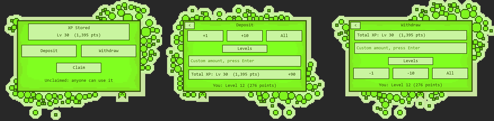

# {C} XP Table

A Forge 1.20.1 mod that adds a green **XP Table**: an enchanting-table-style block that stores experience.



## Features
- **Unlimited XP storage** inside the block. XP is stored as exact points, so storing and taking back never loses any.
- **Keeps its XP when broken**: the dropped table carries the XP (and claim), and the tooltip shows how much.
- **Claim button**: unclaimed tables can be used by anyone; a claimed table can only be used or broken by its owner (server ops can still break or unclaim it). The owner's name floats above the table.
- **Menu**: Deposit / Withdraw pages with `+1`, `+10`, `All`, a Levels/Points switch and a custom amount box. Every click moves XP instantly and plays the XP orb sound.

## Recipe
```
Book     Diamond          Book
Diamond  Bottle o' Enchanting  Diamond
Book     Diamond          Book
```

## Install
Forge **1.20.1** (47.x). Put the jar in the `mods` folder of the **server and every player** (it's needed on both sides).

## Building
JDK 17, then `gradlew build`. The jar ends up in `build/libs/`.
The menu backgrounds are generated pixel art: `python tools/make_gui.py src/main/resources/assets/xptable/textures/gui` (needs Pillow).

## License
Code and menu art: MIT (see `LICENSE`). Block and book textures are recoloured vanilla Minecraft textures and belong to Mojang.
